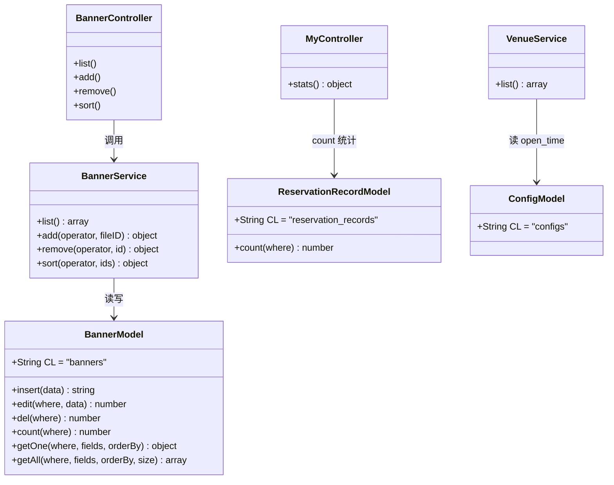
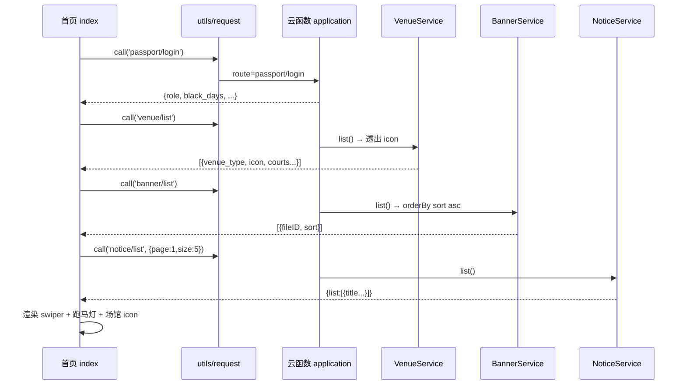
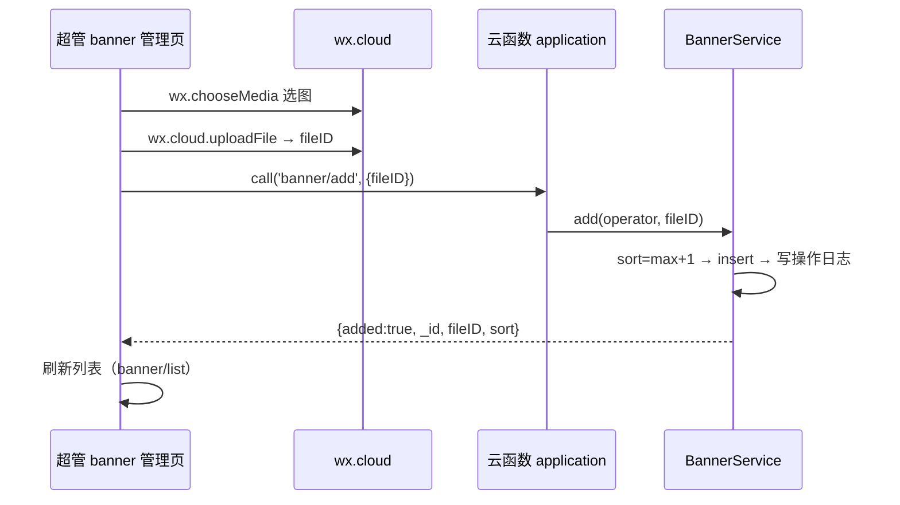
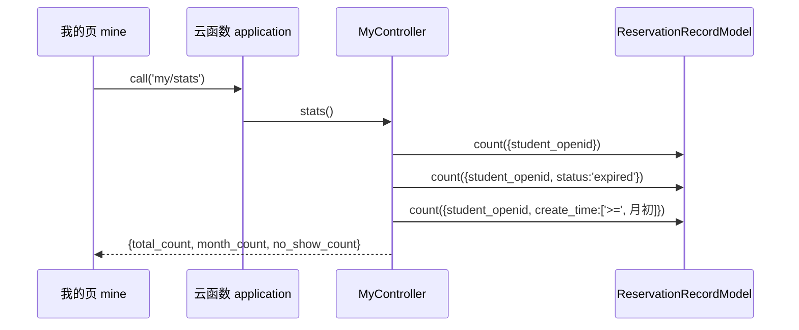
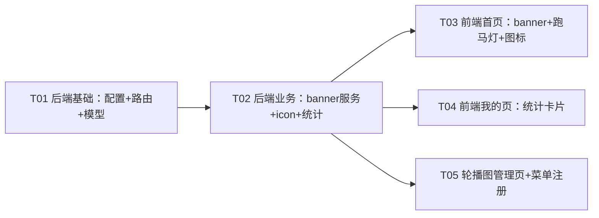

# 体育馆预约小程序 · 增量系统设计 + 任务分解

> 架构师：高见远（software-architect）
> 范围：在现有微信云开发小程序（自研 MVC 框架）上做 4 项增量需求，2 项明确不做。
> 本次改动**最小侵入**：不引入新框架、不引入新 npm 依赖、复用既有 `route → controller → service → model` 与 `configs`/`banners` 集合。

---

## Part A：系统设计

### 1. 实现方案 + 框架选型

#### 1.1 技术难点与结论（基于实读代码）

| 需求 | 现状（已核实） | 方案 |
|------|----------------|------|
| R1 场馆图标 | `venue_service.list()` 返回 `{venue_type, venue_type_name, count, courts}`，**无 icon**；前端 `pages/index/index.wxml` 硬编码 🏸/🏓/🏋️ | 在 `config.VENUE_TYPES` 每个类型补 `icon` 字段，`venue_service.list()` 透出 `icon`，前端改用 `{{item.icon}}` |
| R2 轮播 banner | `config_service.activityPic()` 为**单图**设计：前端 `wx.cloud.uploadFile` 得 fileID → 调 `config/activity_pic`（role 3）→ 存 `configs` 集合 `activity_pic` 键；`config/get` 可匿名读 | **新增 `banners` 集合**（多图天然适合文档化 CRUD/排序），4 个接口：匿名读列表、超管上传/删除/排序；前端 `<swiper>` 展示；无图时用本地默认图兜底 |
| R3 滚动公告 | 首页 `pages/index` 调 `notice/latest` 弹 `notice-modal`；`app.json` 已全局注册 `t-notice-bar`（TDesign，已装） | 复用 `notice/list`，首页取最近 N 条标题拼接成单行，用 `t-notice-bar` 的 `marquee` 属性做跑马灯；**移除首页弹窗逻辑**，保留 `notice-modal` 组件本身 |
| R4 预约统计 | `reservation_records` 状态已确认：`pending / checked_in / cancelled / expired`，**爽约=expired**（`job_service.js` 扫描 pending→expired）；`my_controller` 目前无统计接口 | 新增 `my/stats` 路由，直接复用 `ReservationRecordModel.count()` 三次（累计/本月/爽约），前端 `pages/mine` 加三列统计卡片 |

#### 1.2 选型说明

- **图片存储方式**：沿用现有 `activity_pic` 的做法——前端 `wx.chooseMedia` + `wx.cloud.uploadFile` 拿到 `cloud://` fileID，后端只存 fileID 字符串。前端 `<image src="cloud://...">` 基础库 2.2.3+ 可直接渲染云文件，无需 `getTempFileURL` 转换。
- **轮播数据结构**：选择**新增集合 `banners`**，而非把 `activity_pic` 改成数组存 `configs`。理由：多图「增/删/排序」是典型的文档级 CRUD，集合 + `Model.getAll(orderBy sort)` 最直接；`configs` 的 `insertOrUpdate` 面向「单 key 单 value」，改数组语义反而绕。`activity_pic` 保留弃用（不删，避免影响历史日志与兼容）。
- **排序接口**：`banner/sort` 接收前端按顺序传回的完整 `ids[]`，后端按索引重写 `sort`，一次搞定任意重排，无需 `move up/down` 双接口。
- **跑马灯**：直接复用已注册的 TDesign `t-notice-bar`（`marquee="{{true}}"` 即滚动），不另写 CSS 动画。
- **统计**：不做聚合管道，三次 `count()` 简单、可读、满足体量。
- **架构模式**：完全遵循现有自研 MVC（`route.js` → `controller` → `service` → `model`），无新抽象层。

---

### 2. 文件列表（相对项目根目录 `gymreserve/`）

**后端（cloudfunctions/cloud/）新增：**

```
cloudfunctions/cloud/project/model/banner_model.js
cloudfunctions/cloud/project/service/banner_service.js
cloudfunctions/cloud/project/controller/banner_controller.js
```

**后端（cloudfunctions/cloud/）修改：**

```
cloudfunctions/cloud/config/config.js          # COLLECTION.banners + VENUE_TYPES.icon
cloudfunctions/cloud/config/route.js           # banner/* 与 my/stats 路由
cloudfunctions/cloud/project/service/venue_service.js   # list() 透出 icon
cloudfunctions/cloud/project/controller/my_controller.js # 新增 stats()
```

**前端（miniprogram/）新增：**

```
miniprogram/pages/admin/banner/banner.js
miniprogram/pages/admin/banner/banner.wxml
miniprogram/pages/admin/banner/banner.wxss
miniprogram/pages/admin/banner/banner.json
miniprogram/images/banner_default.jpg          # 从 C:\Users\huang\Desktop\体育馆.jpg 复制
```

**前端（miniprogram/）修改：**

```
miniprogram/pages/index/index.js      # R1 图标 + R2 banner + R3 跑马灯，移除弹窗逻辑
miniprogram/pages/index/index.wxml    # swiper banner + 跑马灯 + 图标字段 + 移除 notice-modal
miniprogram/pages/index/index.wxss    # banner/跑马灯样式
miniprogram/pages/mine/mine.js        # 拉取 my/stats
miniprogram/pages/mine/mine.wxml      # 统计卡片
miniprogram/pages/mine/mine.wxss      # 统计卡片样式
miniprogram/pages/admin/admin.wxml    # 新增「轮播图管理」入口（role>=3）
miniprogram/app.json                  # 注册 pages/admin/banner/banner 页面
```

> 说明：`init_data.js` 无需改——`createCollections()` 遍历 `Object.values(config.COLLECTION)`，给 `COLLECTION` 加 `banners` 后 `init/run` 会自动建集合。

---

### 3. 数据结构与接口设计

#### 3.1 轮播图多图数据结构（新集合 `banners`）

`banner_model.js`：

```
CL = 'banners'
DB_STRUCTURE = {
  _id:         'string',   // 云开发自动生成
  fileID:      'string',   // 云存储文件 ID（cloud://...）
  sort:        'number',   // 排序值，越小越靠前（从 0 开始）
  create_time: 'number',   // 毫秒时间戳
  update_time: 'number',   // 毫秒时间戳
}
```

集合在 `config.COLLECTION` 中新增：`banners: 'banners'`。

#### 3.2 轮播图接口（route.js 路由表）

| 路由 | controller.action | role | 入参 | 返回 data |
|------|-------------------|------|------|-----------|
| `banner/list` | banner_controller.list | 0 | 无 | `[{_id, fileID, sort, create_time, update_time}]`（按 sort asc） |
| `banner/add` | banner_controller.add | 3 | `{ fileID: string }` | `{ added: true, _id, fileID, sort }` |
| `banner/delete` | banner_controller.remove | 3 | `{ id: string }` | `{ removed: true }` |
| `banner/sort` | banner_controller.sort | 3 | `{ ids: [id1, id2, ...] }`（按展示顺序） | `{ sorted: true }` |

`BannerService` 关键逻辑：
- `list()`：`BannerModel.getAll({}, '*', { sort: 'asc' })`。
- `add(operator, fileID)`：取当前最大 `sort`，`nextSort = (max || 0) + 1`，`insert({fileID, sort, create_time, update_time})`，写 `operation_logs`（module='config'，action='banner_add'）。
- `remove(operator, id)`：`getOne(id)` 不存在则 AppError，`del(id)`，写日志（action='banner_delete'）。
- `sort(operator, ids)`：校验数组非空且元素为字符串，逐条 `edit(id, { sort: index, update_time })`（index 从 0 起），写日志（action='banner_sort'）。

#### 3.3 `my/stats` 接口

| 路由 | controller.action | role | 入参 | 返回 data |
|------|-------------------|------|------|-----------|
| `my/stats` | my_controller.stats | 1 | 无 | `{ total_count, month_count, no_show_count }` |

字段定义（数据源 `reservation_records`，爽约状态已确认 `expired`）：

```
total_count   累计预约次数 = count({ student_openid })                          // 所有流水
month_count   本月预约次数 = count({ student_openid, create_time: ['>=', 本月1日0点时间戳] })
no_show_count 爽约次数     = count({ student_openid, status: 'expired' })       // 历史累计
```

`my_controller.stats()` 实现要点：`const monthStart = timeUtil.today().slice(0,8) + '01'; const ts = timeUtil.dateStartTimestamp(monthStart);`。

#### 3.4 `venue/list` 新增 `icon` 改动点

- `config.VENUE_TYPES` 改为：

```js
VENUE_TYPES: {
  badminton: { name: '羽毛球场', count: 6,  icon: '🏸' },
  pingpong:  { name: '乒乓球场', count: 6,  icon: '🏓' },
  gym:       { name: '健身房',   count: 20, icon: '🏋️' },
},
```

- `venue_service.list()` 在 `result.push(...)` 时补 `icon: info.icon || '🏟️'`，返回项变为 `{ venue_type, venue_type_name, count, icon, courts }`（courts 内不变）。

#### 3.5 类图（classDiagram）

见 `docs/class-diagram.mermaid`（下文亦附）：



---

### 4. 程序调用流程（sequenceDiagram）

完整见 `docs/sequence-diagram.mermaid`，三条关键链路如下：

**① 首页加载（拉轮播 + 公告 + 场馆图标）**



**② 超管上传轮播图**



**③ 我的页统计**



---

### 5. Anything UNCLEAR（已给出默认假设，不阻塞设计）

1. **累计/本月预约次数是否排除「已取消」**：默认口径为「所有预约流水（含取消）」，即累计=全部流水、本月=本月下单的全部流水。若产品要求排除取消，仅需在 `count` 的 where 加 `status: ['!=', 'cancelled']`（一行）。
2. **「本月」按哪种时间**：默认按预约**下单时间 `create_time`** 落在本月；若改为「场次日期 `date` 在本月」，用 `date: ['>=', 'YYYY-MM-01']` 字符串比较即可。
3. **爽约次数维度**：默认历史累计爽约（status=expired）；未做「本月爽约」拆分。
4. **轮播默认图**：默认采用**前端本地兜底图** `images/banner_default.jpg`（banner 列表为空时显示），不预置云存储种子数据。
5. **轮播图是否需「启用/停用」开关**：默认不需要，删除即下架。
6. **旧 `activity_pic` 单图能力**：保留弃用（前端不再调用，`config/get` 仍返回但首页不用），不删除，避免影响历史日志与兼容。
7. **低版本基础库**：`<image src="cloud://fileID">` 需基础库 2.2.3+；默认直接渲染，如遇低版本再加 `getTempFileURL` 兜底。

---

## Part B：任务分解

### 6. 依赖包列表

```
（无新增 npm 依赖）
- 微信原生：swiper、wx.chooseMedia、wx.cloud.uploadFile、<image>
- 已有依赖：TDesign t-notice-bar / t-cell / t-button（已在 app.json 注册）
- 后端：wx-server-sdk（现有）
```

### 7. 任务列表（按实现顺序，后端先、前端后）

| Task | 名称 | 源文件 | 依赖 | 优先级 |
|------|------|--------|------|--------|
| T01 | 后端基础改造：配置 + 路由 + banner 数据模型 | `config/config.js`、`config/route.js`、`project/model/banner_model.js` | 无 | P0 |
| T02 | 后端业务实现：banner 服务/控制器 + venue 图标 + my 统计 | `project/service/banner_service.js`、`project/controller/banner_controller.js`、`project/service/venue_service.js`、`project/controller/my_controller.js` | T01 | P0 |
| T03 | 前端首页改造：轮播 banner + 跑马灯公告 + 场馆图标 | `pages/index/index.js`、`pages/index/index.wxml`、`pages/index/index.wxss`、`images/banner_default.jpg`（复制默认图） | T02 | P0 |
| T04 | 前端「我的」页预约统计卡片 | `pages/mine/mine.js`、`pages/mine/mine.wxml`、`pages/mine/mine.wxss` | T02 | P0 |
| T05 | 轮播图管理页 + 管理菜单/页面注册 | `pages/admin/banner/banner.{js,wxml,wxss,json}`、`pages/admin/admin.wxml`、`app.json` | T02 | P0 |

各任务具体改动：

**T01**
- `config/config.js`：`COLLECTION` 增加 `banners`；`VENUE_TYPES` 每项加 `icon`。
- `config/route.js`：新增 `banner/list`(0)、`banner/add`(3)、`banner/delete`(3)、`banner/sort`(3)、`my/stats`(1)。
- `project/model/banner_model.js`：新建，`CL='banners'` + `DB_STRUCTURE`。

**T02**
- `project/service/banner_service.js`：`list/add/remove/sort`。
- `project/controller/banner_controller.js`：四个 action + 参数校验（fileID must|string；id must|string；ids must|array）。
- `project/service/venue_service.js`：`list()` 补 `icon`。
- `project/controller/my_controller.js`：新增 `stats()`。

**T03**
- `pages/index/index.js`：`init()` 中新增 `banner/list` + `notice/list`；删除 `notice/latest`、`showNotice`、`notice`、`onCloseNotice`、`shownNoticeId` 相关；data 增加 `banners`、`noticeText`。
- `pages/index/index.wxml`：顶部加 `<swiper>` banner + 本地默认图兜底；加跑马灯 `t-notice-bar`；场馆 emoji 改 `{{item.icon}}`；删除底部 `<notice-modal>`。
- `pages/index/index.wxss`：banner/跑马灯样式。
- 复制 `C:\Users\huang\Desktop\体育馆.jpg` → `miniprogram/images/banner_default.jpg`。

**T04**
- `pages/mine/mine.js`：登录后若 `role>=1` 调 `my/stats`，写入 `stats`。
- `pages/mine/mine.wxml`：三列统计卡片。
- `pages/mine/mine.wxss`：卡片样式。

**T05**
- `pages/admin/banner/banner.{js,wxml,wxss,json}`：列表 + 上传（chooseMedia→uploadFile→banner/add）+ 删除 + 上移/下移（本地换序后调 banner/sort）。
- `pages/admin/admin.wxml`：role>=3 分组加「轮播图管理」入口。
- `app.json`：`pages` 数组注册 `pages/admin/banner/banner`。

### 8. 共享知识（跨文件约定）

- **统一返回**：后端所有接口返回 `{ code, msg, data }`；`code===200` 成功。前端 `request.call(route, params, {silent})` 成功时 `resolve(r.data)`。
- **角色常量**：后端引用 `config.ROLE.SUPER_ADMIN`(=3)；路由表 `role` 为最小所需角色；前端通过 `passport/login` 返回的 `role` 数字判断，如 `role >= 3` 显示超管入口。
- **config 键命名**：`configs` 集合 `_id = key`（open_time / activity_pic / subscribe_tpl），`value` 为任意 JSON。**本轮新增内容不走 configs，走独立 `banners` 集合**。
- **Model 用法**：`Model.count(where)` / `getAll(where, fields, orderBy, size)` / `edit(where, data)` / `del(where)` / `getOne(where)`；where 支持运算符数组 `['>=', val]`、`['!=', val]`；fields 传 `'a,b,c'` 或 `'*'`；orderBy 传 `{ sort: 'asc' }`。
- **时间**：后端统一 `timeUtil.now()`（毫秒时间戳）、`timeUtil.today()`（"YYYY-MM-DD"）、`timeUtil.dateStartTimestamp(dateStr)`（北京某日 0 点时间戳）；前端展示用 `utils/util.js` 的 `timestamp2Time`。
- **图片上传**：前端 `wx.chooseMedia` → `wx.cloud.uploadFile({cloudPath, filePath})` 得 fileID，后端仅存 fileID；`<image src="cloud://...">` 直接渲染。
- **操作日志**：写 `OperationLogModel.insert({ module, action, operator_openid, operator_name, operator_role, target_desc, detail, create_time })`；本轮 banner 操作复用 `module='config'`，action 用 `banner_add / banner_delete / banner_sort`（与现有 `activity_pic` 同 module，`pages/admin/logs` 的「配置」分类可直接看到）。
- **公告状态**：`notices.status` 为 `published` / `deleted`；`notice/list` 只返回 `published`。
- **预约流水状态**：`reservation_records.status` ∈ `pending / checked_in / cancelled / expired`；**爽约 = expired**。
- **`request.call` 约定**：首页/我的页静默请求一律 `{ silent: true }` 避免误弹 toast；表单操作不传 silent。

### 9. 任务依赖图


