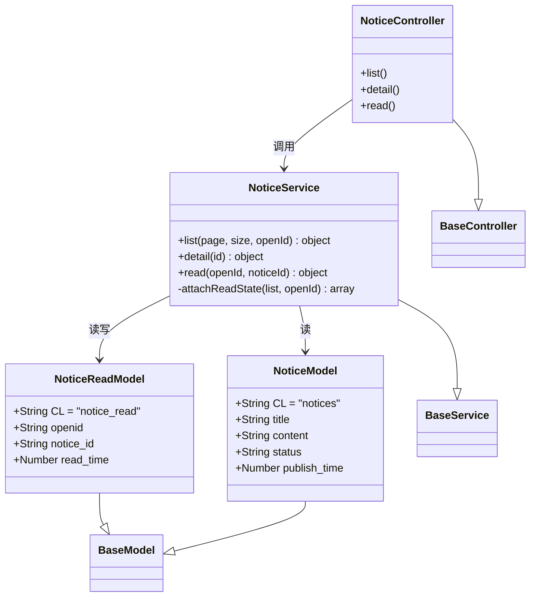
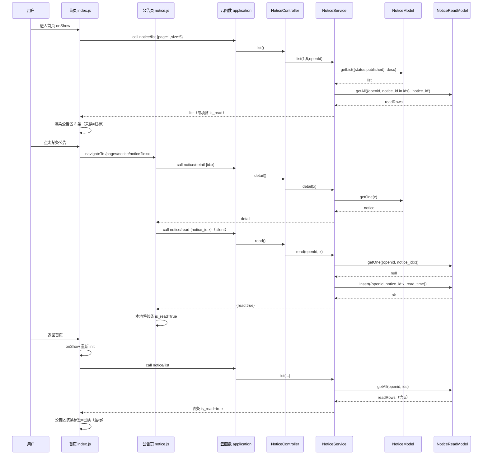
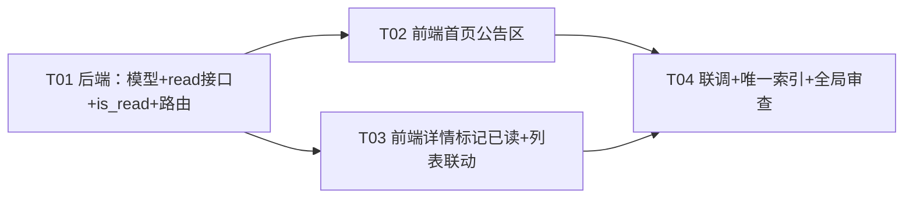

# 体育馆预约小程序 · 增量设计：首页「公告区 + 已读/未读」

> 架构师：高见远（software-architect）
> 范围：在现有微信云开发小程序（自研 MVC 框架）上，为「公告」新增**已读/未读**能力，并在首页新增「公告」区。
> 原则：**最小侵入**——不引入新框架、不引入新 npm 依赖，完全复用 `route → controller → service → model` 与现有 `notices` 集合，仅新增一个 `notice_read` 集合。

---

## Part A：系统设计

### 1. 实现方案 + 框架选型

#### 1.1 核心技术难点

| 难点 | 结论（已核实代码） |
|------|------------------|
| `notice_read` 的唯一性如何保证 | 微信云开发数据库（MongoDB 风格文档型）**支持唯一索引**，但 **`wx-server-sdk` 的 `db.collection()` 不提供 `createIndex()` 方法**（本项目 `framework/database/db_util.js` 也未封装）。唯一索引只能通过「云开发控制台 → 数据库 → notice_read → 索引管理」手动创建，或走服务端 HTTP API `updateIndex`（需 access_token，不适合云函数内自建）。**结论：控制台唯一索引 = 数据库层最终兜底；代码层必须自带「查询去重 + 幂等插入」兜底**，避免工程师漏配索引时产生重复记录。 |
| `notice/read` 幂等 | 采用「先查后插」+「捕获唯一键冲突静默成功」：先 `getOne({openid, notice_id})`，不存在才 `insert`；并发重复插入时依赖唯一索引报 duplicate key，捕获该错误返回成功即可。 |
| `notice/list` 返回 `is_read` 避免 N+1 | 首页最多 3 条、列表页默认 20 条，规模小。推荐**一次性批量查**：取本页公告 `_id` 列表 → `NoticeReadModel.getAll({openid, notice_id: ['in', ids]}, 'notice_id')` → 用 Set 打标，共 1 次额外查询。 |
| 匿名用户（无 openid） | `notice/list`/`notice/detail` 为 `role:0`（匿名可看），但小程序 `callFunction` 下 `WXContext.OPENID` 恒存在；HTTP 触发时为空。因此 `is_read` 在 `openId===''` 时**恒为 false**；`notice/read` 需登录态，设 `role:1`，防止匿名写入 `openid=''` 的脏数据。 |

#### 1.2 唯一索引结论（重点，避免工程师踩坑）

- **支持**：云开发数据库支持唯一索引，建在 `notice_read` 集合的 `(openid, notice_id)` 复合字段上，方向均为升序，勾选「唯一」。
- **不支持的路径**：`wx-server-sdk` 无 `collection().createIndex()`；不要在云函数里尝试代码建索引。
- **必须双保险**：
  1. **控制台手动建索引**（运维步骤，作为任务验收项）：`notice_read` → 索引管理 → 新建「组合索引」`openid(升序) + notice_id(升序)`，唯一=true。
  2. **代码层幂等**（本节 1.3）：即使索引漏配，也能保证 99% 场景不产生重复（并发极小概率重复，可接受；配了索引后 100% 不重复）。

#### 1.3 `notice/read` 幂等实现（伪代码，供工程师落地）

```text
read(openId, noticeId):
    if openId 为空: throw AppError('未登录', 4001)
    校验公告存在且 status='published'（不存在/已删 → AppError）
    exist = NoticeReadModel.getOne({ openid, notice_id })
    if exist: return { read: true }          // 幂等：已读直接返回
    try:
        NoticeReadModel.insert({ openid, notice_id, read_time: now() })
    catch e:
        if 是唯一键冲突(错误信息含 "duplicate"): return { read: true }  // 幂等
        else: throw e
    return { read: true }
```

> 说明：不更新 `read_time`，保留「首次阅读时间」语义；如产品要求「最近一次阅读时间」，把 `exist` 分支改为 `edit(exist._id, { read_time: now() })` 即可。

#### 1.4 `notice/list` 批量 is_read 实现

```text
list(page, size, openId):
    res = NoticeModel.getList({status:'published'}, '*', {publish_time:'desc'}, page, size)
    if openId 非空 且 res.list 非空:
        ids = res.list.map(n => n._id)
        readRows = NoticeReadModel.getAll({ openid, notice_id: ['in', ids] }, 'notice_id')
        readSet = { readRows[].notice_id -> true }
        res.list.forEach(n => n.is_read = !!readSet[n._id])
    else:
        res.list.forEach(n => n.is_read = false)
    return res
```

#### 1.5 框架选型

- 无新框架、无新 npm 依赖。沿用现有自研 MVC（`config/route.js` → `project/controller` → `project/service` → `project/model`）。
- 前端沿用 `utils/request.call` + `line-icon`（`bell`/`arrow-right` 图标已存在）+ 主色体系；「更多>>」蓝色、已读蓝/未读红按 PRD 用十六进制写死在 wxss。

---

### 2. 文件列表（相对项目根目录 `gymreserve/`）

**后端（cloudfunctions/cloud/）新增：**

```
cloudfunctions/cloud/project/model/notice_read_model.js
```

**后端（cloudfunctions/cloud/）修改：**

```
cloudfunctions/cloud/project/service/notice_service.js     # list() 批量补 is_read + 新增 read()
cloudfunctions/cloud/project/controller/notice_controller.js # 新增 read()，list() 透传 openId
cloudfunctions/cloud/config/route.js                        # 新增 notice/read 路由(role 1)
```

**前端（miniprogram/）修改：**

```
miniprogram/pages/index/index.js     # 新增 homeNotices + onTapNotice + 格式化
miniprogram/pages/index/index.wxml   # 新增「公告」区
miniprogram/pages/index/index.wxss   # 公告区样式
miniprogram/pages/notice/notice.js   # loadDetail 成功后调 notice/read；修复 onBack 空列表
miniprogram/pages/notice/notice.wxml # 列表项可选展示已读/未读标签
miniprogram/pages/notice/notice.wxss # 标签样式
miniprogram/utils/util.js            # 新增 timestamp2TimeCn(ms) 中文日期格式
```

**文档：**

```
docs/system_design_notice_read.md      # 本设计文档
docs/notice-read-class-diagram.mermaid # 类图
docs/notice-read-sequence-diagram.mermaid # 时序图
```

> 运维步骤（非代码文件）：云开发控制台为 `notice_read` 集合建唯一索引 `(openid, notice_id)`。

---

### 3. 数据结构与接口设计

#### 3.1 新集合 `notice_read`

`notice_read_model.js`：

```
CL = 'notice_read'
DB_STRUCTURE = {
  _id:        'string',   // 云开发自动生成
  openid:     'string',   // 阅读者 openid
  notice_id:  'string',   // 公告 _id
  read_time:  'number',   // 首次阅读毫秒时间戳
}
唯一键：(openid, notice_id)   ← 控制台建唯一索引 + 代码层幂等双保险
集合权限：仅管理端可读写（读写全走云函数，前端不直连）
```

#### 3.2 接口变更

**新增 `notice/read`**

| 项 | 值 |
|----|----|
| 路由 | `notice/read` |
| controller.action | `notice_controller.read` |
| role | 1（需登录；匿名用户不写入已读） |
| 入参 | `{ notice_id: string }`（must） |
| 返回 data | `{ read: true }` |
| 幂等 | 重复调用不产生重复记录，返回相同结果 |
| 失败 | 未登录 4001；公告不存在/已删除 1600 |

**改造 `notice/list`**

- 入参不变：`{ page, size }`（`page` 默认 1，`size` 默认 20）。
- 返回结构 `data` 不变（仍是 `{ page, size, list, total, count }`），仅 **`list` 内每项新增布尔字段 `is_read`**：
  - `true`：当前用户已读；
  - `false`：未读，或匿名（无 openid）。
- 原字段 `_id/title/content/status/author_openid/author_name/publish_time/update_time` 全部保留。

**不改动**：`notice/latest`、`notice/detail`（详情仍由前端调 `notice/read` 单独标记）。

#### 3.3 类图（classDiagram）

见 `docs/notice-read-class-diagram.mermaid`，正文亦附：



---

### 4. 程序调用流程（sequenceDiagram）

完整见 `docs/notice-read-sequence-diagram.mermaid`，核心链路「点开公告 → 标记已读 → 返回首页已读变蓝」：



---

### 5. Anything UNCLEAR（已给默认假设，不阻塞设计）

1. **唯一索引是否已由工程师在控制台配置**：本次设计假设「未配置」，故强制代码层幂等兜底；控制台建索引作为 T01/T04 验收项。若已配置，代码仍兼容。
2. **日期格式「YYYY年M月D日」是否补零**：PRD 写法为不补零（如 `2026年11月4日`）；现有 `timestamp2Time` 会补零（`2026年11月04日`）。默认新增 `timestamp2TimeCn` 不补零，若有异议改用补零版。
3. **首页滚动公告条 `notice-tip` 是否保留**：默认**保留**（与新增「公告」区并存，二者都从 `notice/list` 取数）；若产品认为冗余可后续移除。
4. **已读/未读标签精确配色**：PRD 只说「已读蓝/未读红」，未给色值；默认已读 `#1f6feb`、未读 `#e34d59`、更多 `#1f6feb`。
5. **公告列表页是否也要显示已读/未读标签**：PRD 仅要求首页，但 `notice/list` 已为列表页也返回 `is_read`，默认**顺带**在列表页展示（成本极低、体验一致）。
6. **`read_time` 语义**：默认「首次阅读时间」，重复阅读不更新；如产品要求「最近阅读时间」需改一行。
7. **`notice/read` 是否校验公告存在**：默认校验（存在且 published 才写），避免脏数据。
8. **弹窗 `notice/latest`**：首页顶部最新公告弹窗**不参与**已读逻辑（PRD 未要求），保持现状。

---

## Part B：任务分解

### 6. 依赖包列表

```
（无新增第三方 npm 依赖）
- 后端：wx-server-sdk（现有，dbUtil 已封装 insert/getOne/getAll/getList）
- 前端：微信原生 navigateTo；TDesign 组件（现有）；line-icon 组件（现有，bell/arrow-right 已存在）
```

### 7. 任务列表（按实现顺序，后端先、前端后）

| Task | 名称 | 源文件 | 依赖 | 优先级 |
|------|------|--------|------|--------|
| T01 | 后端已读数据层与接口 | `project/model/notice_read_model.js`（新）、`project/service/notice_service.js`、`project/controller/notice_controller.js`、`config/route.js` | 无 | P0 |
| T02 | 前端首页「公告」区 | `pages/index/index.js`、`pages/index/index.wxml`、`pages/index/index.wxss`、`utils/util.js` | T01 | P0 |
| T03 | 前端详情页标记已读 + 列表页已读态 | `pages/notice/notice.js`、`pages/notice/notice.wxml`、`pages/notice/notice.wxss` | T01 | P0 |
| T04 | 集成联调 + 控制台唯一索引落地 + 全局审查 | 控制台 `notice_read` 唯一索引（运维）、`docs/system_design_notice_read.md` 同步、手工/冒烟验证 | T01、T02、T03 | P1 |

各任务具体改动：

**T01（P0）后端已读数据层与接口**
- `project/model/notice_read_model.js`：新建，`CL='notice_read'` + `DB_STRUCTURE`（openid/notice_id/read_time）。
- `project/service/notice_service.js`：
  - `list(page, size, openId)`：getList 后调 `attachReadState`（批量 `getAll` + Set 打标，openId 为空恒 false）。
  - 新增 `read(openId, noticeId)`：先校验公告存在且 published → getOne 去重 → insert → try/catch 捕获 duplicate key 幂等。
- `project/controller/notice_controller.js`：
  - `list()` 改为 `new NoticeService().list(input.page, input.size, this._openId)`。
  - 新增 `read()`：`validateData({ notice_id: 'must|string|name=公告ID' })` → `service.read(this._openId, input.notice_id)`。
- `config/route.js`：公告区新增 `'notice/read': { controller: 'notice_controller', action: 'read', role: 1 }`。
- 验收：`notice/list` 每项含 `is_read`；`notice/read` 连调两次不产生重复记录。

**T02（P0）前端首页「公告」区**
- `pages/index/index.js`：
  - data 新增 `homeNotices: []`。
  - `init()` 中复用现有 `notice/list`（size 5）结果，`homeNotices = notices.slice(0,3).map(n => ({...n, dateText: util.timestamp2TimeCn(n.publish_time)}))`。
  - 新增 `onTapNotice(e)` → `wx.navigateTo('/pages/notice/notice?id=' + e.currentTarget.dataset.id)`；`goNotice()` 复用为「更多>>」跳列表。
- `pages/index/index.wxml`：在滚动公告条后新增公告区（`wx:if="{{homeNotices.length}}"`）：头部 `line-icon name="bell"` + 「公告」 + 右侧「更多」+ `line-icon name="arrow-right"`（蓝）；下方 3 条，每条 = 已读/未读标签 + 标题 + 中文日期，`bind:tap="onTapNotice"`。
- `pages/index/index.wxss`：公告区卡片 + 头部 + 已读蓝/未读红标签 + 更多蓝样式。
- `utils/util.js`：新增 `timestamp2TimeCn(ms)` 返回 `YYYY年M月D日`（不补零）。
- 验收：首页展示 3 条公告，未读红/已读蓝，点击跳详情，「更多>>」跳列表。

**T03（P0）前端详情页标记已读 + 列表页已读态**
- `pages/notice/notice.js`：
  - `onLoad(options)`：改为**始终 `loadList()`**，若带 `options.id` 再 `loadDetail(options.id)`（修复从首页直达详情后 `onBack` 空列表问题）。
  - `loadDetail(id)`：detail 成功后 `request.call('notice/read', { notice_id: id }, { silent: true })`，成功后本地把 list 中对应项 `is_read=true`。
- `pages/notice/notice.wxml`：列表项可选展示已读/未读标签（复用首页配色）。
- `pages/notice/notice.wxss`：标签样式。
- 验收：详情打开即标记已读；返回列表该条变已读；返回首页（onShow）该条变蓝。

**T04（P1）集成联调 + 索引落地 + 全局审查**
- 控制台为 `notice_read` 建唯一索引 `(openid, notice_id)`（运维步骤，工程师确认或告知团队负责人）。
- 边界审查：匿名/HTTP 访问 `notice/list`（is_read 全 false）、`notice/read` 匿名 4003、重复点开幂等、并发快速双击不产生重复记录、`size>0` 空列表不报错。
- 同步本文档与 mermaid（如有偏差）。

### 8. 共享知识（跨文件约定）

- **统一返回**：后端所有接口返回 `{ code, msg, data }`，`code===200` 成功；前端 `request.call(route, params, {silent})` 成功时 `resolve(r.data)`。
- **is_read 字段**：`notice/list` 的 `list` 每项新增布尔 `is_read`；匿名（openid 为空）恒 false；前端用它控制「已读蓝 / 未读红」标签。
- **notice_read 唯一键**：`(openid, notice_id)`；集合权限建议「仅管理端可读写」（读写全走云函数）。
- **notice/read 约定**：入参 `notice_id`（不是 `id`）；返回 `{ read: true }`；必须静默调用（`{silent:true}`），失败不影响详情展示。
- **角色**：`notice/list`/`notice/detail` 保持 `role:0`；`notice/read` 为 `role:1`（需登录）。
- **时间**：后端 `publish_time`/`read_time` 均为毫秒时间戳；前端展示日期用 `utils/util.js` 新增的 `timestamp2TimeCn(ms)`（`YYYY年M月D日`，不补零）；详情/列表旧字段仍用 `timestamp2Time(ms, 'Y-M-D h:m')`。
- **Model 查询**：`getAll(where, fields, orderBy, size)`；where 支持 `['in', ids]`；fields 传 `'notice_id'` 只取必要字段减少体积。
- **幂等判重错误**：云开发数据库唯一键冲突错误信息含 `duplicate`（大小写不敏感），按 `String(e.errMsg || e.message || e).toLowerCase().indexOf('duplicate') >= 0` 判定。

### 9. 任务依赖图


